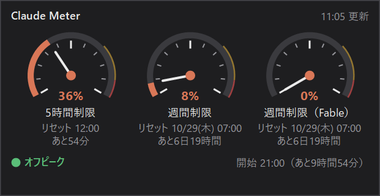
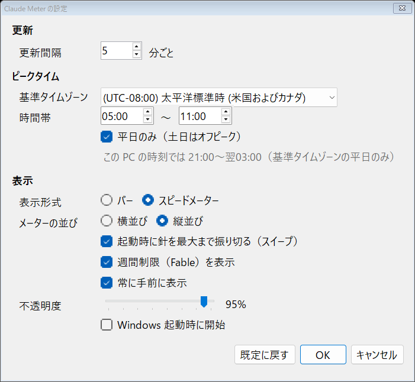

# Claude Meter

Claude の利用制限の使用状況を、デスクトップの隅に小さく常時表示する Windows / Mac アプリです（Mac 版は下の「Mac 版」を参照）。

- 5時間制限の使用率とリセット時刻
- 週間制限（全モデル）の使用率とリセット時刻
- 週間制限（Fable）の使用率とリセット時刻
- 今がピークタイムかオフピークか、次に切り替わる時刻

管理者権限は不要です。インストール作業もありません。

表示形式はバーとスピードメーターから選べます（設定画面で切り替え）。



## 使い方

1. `bin\ClaudeMeter.exe` をダブルクリックして起動します。
2. 初回は Claude Code CLI でログインしておいてください（`claude` を起動して `/login`）。アプリはそのログイン情報（`%USERPROFILE%\.claude\.credentials.json`）を使います。

| 操作 | 内容 |
|---|---|
| ドラッグ | ウィンドウを移動（位置は保存されます） |
| ダブルクリック | 今すぐ更新 |
| 右クリック／タスクトレイのアイコン | メニュー（更新・常に手前・Windows 起動時に開始・設定・終了） |
| トレイアイコンを左クリック | 表示／非表示の切り替え |

データは5分ごとに自動更新します。メーターの色は 70% 未満で青、70% 以上で黄、90% 以上で赤になります。

## ビルド

Windows に標準で入っている .NET Framework 4.x の `csc.exe` でビルドします（SDK のインストール不要）。

```bash
build.bat
```

`bin\ClaudeMeter.exe` が作られます。exe のアイコンには `src\app.ico` が埋め込まれます。アイコンを作り直すときは `tools\make-icon.ps1` を実行してください。

## 設定

右クリックメニュー（またはタスクトレイのメニュー）の「設定...」で設定画面を開きます。OK を押すとすぐに反映され、アプリの再起動は要りません。



| 項目 | 既定値 | 説明 |
|---|---|---|
| 更新間隔 | 5分 | 使用状況を自動で取得する間隔（1〜60分） |
| 基準タイムゾーン | 太平洋標準時（米国およびカナダ） | ピークタイムの時刻を決めるタイムゾーン（夏時間は自動で考慮） |
| 時間帯 | 05:00〜11:00 | ピークタイムの開始・終了（基準タイムゾーンでの時刻）。下にこの PC の時刻に換算した時間帯が表示されます |
| 平日のみ | オン | オンのとき、基準タイムゾーンの土日はオフピーク扱い |
| 表示形式 | バー | 横バー表示か、車のスピードメーターのような文字盤表示かを選択 |
| メーターの並び | 横並び | スピードメーター表示のとき、文字盤を横に並べるか縦に並べるか |
| 起動時に針を最大まで振り切る（スイープ） | オン | スピードメーター表示のとき、起動時（とスピードメーターへ切り替えたとき）に針が一度 100% まで振れてから実際の値に戻ります |
| 週間制限（Fable）を表示 | オン | Fable を使えないプランではオフにすると表示から外せます |
| 常に手前に表示 | オン | メーターを他のウィンドウより手前に表示 |
| 不透明度 | 95% | メーターの不透明度（30〜100%） |
| Windows 起動時に開始 | オフ | サインイン時に自動で起動（管理者権限不要） |

「既定に戻す」で上の既定値に戻せます。既定のピークタイムは「平日の米国太平洋時間 5:00〜11:00」（日本時間では夏時間中 21:00〜翌3:00、冬時間中 22:00〜翌4:00）です。Anthropic が定義を変えた場合は設定画面で変更してください。

設定は `%APPDATA%\ClaudeMeter\settings.json` に保存されます。
## 仕組み

- 使用状況は Claude Code の `/usage` と同じ `https://api.anthropic.com/api/oauth/usage` から取得します。Fable の週間枠は応答の `limits[]` のうち `scope.model.display_name` が `Fable` の項目です。
- アクセストークンが期限切れのときは、Claude Code と同じ方法でリフレッシュし、新しいトークンを `.credentials.json` に書き戻します（Claude Code CLI もそのまま使い続けられます）。
- 自動起動は `HKEY_CURRENT_USER\...\Run` に登録するので管理者権限は要りません。

## 注意

- Anthropic 非公式の個人製ツールです。Anthropic とは関係ありません。
- 使っている usage API は Anthropic の非公開エンドポイントです。仕様が変わると表示できなくなることがあります。
- ログイン情報は Claude Code CLI と共有しています。トークンの更新が Claude Code と同時に起きると、どちらかで再ログインが必要になる場合があります。
- リフレッシュトークンも期限切れになった場合は、`claude` で `/login` し直してください。
- トークンは `api.anthropic.com`（使用状況の取得）と `platform.claude.com`（トークン更新）以外には送信しません。

## Mac 版

`mac/` に Swift（AppKit）で作った Mac 版があります。機能・表示・設定項目は Windows 版と同じです。macOS 13 以降で動きます。

### ビルド

Xcode か Command Line Tools（`xcode-select --install`）の `swiftc` でビルドします。管理者権限は要りません。

```bash
mac/build.sh
```

`mac/build/ClaudeMeter.app` が作られます（Apple シリコン・Intel 両対応）。好きな場所（`~/Applications` など）に置いて開いてください。署名はその場限りの ad-hoc 署名なので、別の Mac にコピーした場合は Gatekeeper に止められます。そのときは右クリック →「開く」で起動してください。

### Windows 版との違い

| 項目 | Mac 版 |
|---|---|
| ログイン情報 | キーチェーンの「Claude Code-credentials」（Claude Code CLI が保存する場所）。無ければ `~/.claude/.credentials.json`。キーチェーンは `/usr/bin/security` 経由で読み書きするので、許可ダイアログは出ません |
| タスクトレイ | メニューバーのアイコン（クリックでメニュー、カーソルを当てると使用率） |
| 自動起動 | メニューの「ログイン時に開始」（`SMAppService` で登録。システム設定の「ログイン項目」にも出ます） |
| 設定の保存先 | `~/Library/Application Support/ClaudeMeter/settings.json`（キー名は Windows 版と同じ。`x` / `y` はウィンドウ左上の画面座標） |
| Dock | 表示しません |

### 動作確認用のオプション

描画を PNG に保存して終了します（設定ファイルは書き換えません）。

```bash
mac/build/ClaudeMeter.app/Contents/MacOS/ClaudeMeter --snapshot out.png --style gauge,vertical --sample usage.json --sweep 1.0
```

| オプション | 内容 |
|---|---|
| `--style <形式>` | `bar` / `gauge` に `vertical`、`nofable` をカンマでつなげて指定 |
| `--sample <JSON>` | 実際に取得せず、usage API の応答を保存したファイルを使う |
| `--nodata` | 取得せずに描く（データ未取得の状態） |
| `--error <文言>` | エラー行を表示する |
| `--sweep <秒>` | スイープのその時点のコマを描く |
| `--now <ISO 8601>` | 現在時刻を差し替える（ピーク表示や残り時間の確認用） |
| `--scale <倍率>` | 出力の倍率（既定 2） |

`--snapshot-settings <パス>` で設定画面も保存できます。移植のための仕様は [docs/PORTING-mac.md](docs/PORTING-mac.md) にあります。

## ライセンス

[MIT License](LICENSE)
